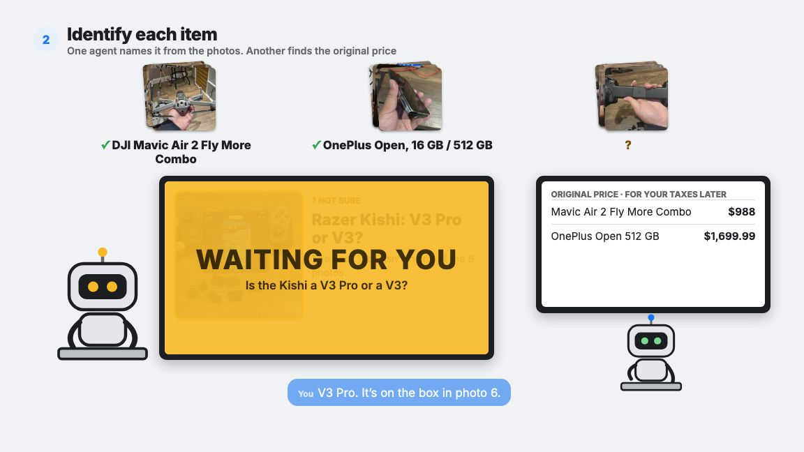

# Resale Hub

**Take the pictures. Claude does the rest, up to the Publish button.**

[](https://doriru89.github.io/resale-hub/)

**[▶ Watch the 54-second demo](https://doriru89.github.io/resale-hub/)** · [MP4](docs/media/resale-hub.mp4)

A drone. An old phone. Earbuds, hard drives, a pasta maker. I always said I'd sell
them, and I never did, because every item means a listing on three sites, a price
nobody can agree on, and a tax question at the end of the year. Resale Hub is the
Claude Code skill I built so the only job left is taking the pictures. In 2026 it
took 99 of my things from a camera roll to sold.

## What it does

| Step | Who | What happens |
|---|---|---|
| 1. Sort | Claude | Groups a camera roll into items. |
| 2. Identify | Claude, then you | Names the exact model from the photos and says which photo told it. Looks up the original price for taxes later. Stops and asks when a photo can't answer. |
| 3. Price | Claude | Reads eBay's sold listings in your signed-in browser, drops the wrong variants, and sets a floor and an ask per marketplace. |
| 4. Draft | Claude | Fills eBay, Facebook Marketplace and Mercari forms (Swappa and Fred Miranda when they fit) and reads each draft back. |
| 5. Publish | **You** | Claude never posts, reprices or messages buyers. |
| 6. Record | Claude | When things sell, reads each order page and buyer chat for the real price, fees and payout. |
| 7. Close the books | Script | Reconciles every eBay order against the records to the cent, writes the year's tax worksheet, and deletes the listing photos. |

## Why it's built this way

- **A human gate where it matters.** The agent does the volume; anything
  irreversible or public (publishing, a price you'd regret, a guess about a model)
  goes to you. "Waiting for you" is a feature, not a failure.
- **One writer.** Every record goes through `resale_store.py`, which validates the
  schema, locks, checks a revision so two sessions can't overwrite each other, and
  writes atomically. A plugin hook blocks any other path, including shell redirects.
- **Refuse instead of backfill.** A sale can't be recorded without its date, payout,
  cost basis and (on eBay) order number, because recording it deletes the photos and
  there is no later. The tax table refuses to write while any order disagrees with
  the records.
- **It knows which sales the IRS cares about.**
  - A personal item sold at a loss isn't income, so there's nothing to report.
  - If a platform sent a 1099-K for it anyway, the gross is backed out at the top
    of Schedule 1.
  - Any sale above cost goes on Form 8949, whichever platform it sold on.
  - A cost that came from MSRP or a guess is fine when the sale is clearly a loss.
    When the payout reaches 60% of it, the store asks for the receipt, since a
    discount could have made it a gain.

  US only, and not tax advice.

## Install

You need [Claude Code](https://claude.com/claude-code), [uv](https://docs.astral.sh/uv/)
and Node.js (for the browser).

**As a plugin** (skill + record guard + browser), inside Claude Code:

```
/plugin marketplace add doriru89/resale-hub
/plugin install resale-hub@resale-hub
```

**Or just the skill:**

```bash
git clone https://github.com/doriru89/resale-hub && cd resale-hub && ./install.sh
```

**First run.** Your records live in `~/resale` (set `RESALE_BASE` to move them).
Copy `examples/config.yaml` there and fill in your filing status and a public pickup
spot. The plugin's browser opens a window with its own profile; sign in to eBay and
Facebook once and it remembers. You can also use the app's built-in browser pane
instead; photos then get uploaded by hand.

**Other agents.** The skill is Markdown plus a Python CLI, so any agent that can read
`skills/resale/SKILL.md` and run shell commands can follow it.

## Use it

```
list the photos in ~/Desktop/to-sell
edit the R104 draft: drop the price to 79
these sold, update my sales
do the 2026 tax table
```

Dashboard, read-only over the same records:

```bash
uv run skills/resale/scripts/dashboard/server.py   # http://127.0.0.1:8377
```

## What stays on your machine

Everything. Records are small YAML files in your data folder (put it in a private git
repo if you want history; the IRS asks you to keep records for three years). Photos
are deleted when an item closes. The browser profile lives in `~/.resale-hub/`.

## Repository

```
skills/resale/            the skill: SKILL.md, references/, scripts/ (store + dashboard)
hooks/                    guard that blocks direct writes to records
.claude-plugin/ .mcp.json plugin manifest and the Playwright browser
tests/                    122 tests for the store
site/                     the demo site (Vite + Remotion), deployed to GitHub Pages
```

```bash
uv run --no-project --with pytest --with pyyaml --with "pydantic>=2" --with pillow --with pillow-heif pytest tests
cd site && npm install && npm run dev       # the demo; npm run render writes the MP4
```

The demo uses my own photos and my own 2026 records. Marketplace screens in it are
recreations, and the project isn't affiliated with any marketplace.

## License

MIT
